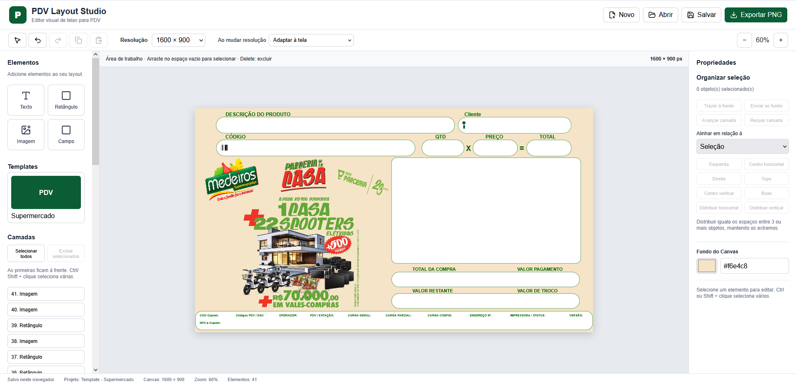

# PDV Layout Studio

Editor visual de telas para PDV, desenvolvido com React, TypeScript, Vite e Konva.

Repositório: [cristianosolutions/pdv-layout](https://github.com/cristianosolutions/pdv-layout).

## Tecnologias utilizadas

React e TypeScript compõem a interface; Vite executa o servidor local e gera a compilação. Konva, integrado por react-konva, desenha e manipula os objetos no canvas. CSS define os estilos, e Lucide React fornece os ícones da interface. Node.js e npm executam as ferramentas e gerenciam as dependências; ESLint analisa o código.

## Projeto em execução

## Instalação e manutenção

Consulte o [guia de instalação, execução e manutenção](docs/DESENVOLVIMENTO.md) para baixar do GitHub, preparar o computador, rodar localmente, modificar o código e enviar melhorias.

## Executar

- `npm install`: instalar dependências.
- `npm run dev`: iniciar o editor local.
- `npm run build`: validar os tipos e gerar a versão de produção em `dist`.
- `npm run lint`: analisar o código.
- `npm test`: executar todos os testes.
- `npm run preview`: visualizar a versão compilada.

## Estrutura

- `src/App.tsx`: interface, propriedades, importação e histórico de elementos.
- `src/components/PDVCanvas.tsx`: renderização, seleção, movimento e redimensionamento.
- `src/types/editor.ts`: tipos dos projetos e elementos.
- `src/templates`: modelos de layout.
- `src/utils/project.ts`: validação de projetos JSON antes de abrir.
- `src/utils/exportImage.ts`: exportação PNG na resolução original, sem controles de seleção.

- `src/experimental/rpdv`: protótipo TXT isolado, com componente, conversor e estilos próprios; fora da interface principal.
- `tests`: testes das funções de layout, redimensionamento, autosave, encaixe e compatibilidade RPdv.
- `public/favicon.svg`: ícone usado pela página.

## Uso

Adicione texto, retângulos, campos e imagens; selecione um elemento para editar suas propriedades. Salvar baixa um projeto JSON, e Abrir restaura esse arquivo. Exportar PNG gera a imagem na resolução selecionada, independentemente do zoom.

O histórico Desfazer/Refazer cobre os elementos. Ao abrir outro projeto, o histórico é reiniciado. O modelo Supermercado usa a resolução 1600 × 900. Projetos são salvos automaticamente neste navegador. Use Salvar para baixar uma cópia JSON.

## Protótipo RPdv (fora da interface)

O protótipo de compatibilidade com TXT foi retirado da interface. O editor principal continua com seu fluxo de criação visual, projetos JSON e exportação PNG. O código experimental foi mantido apenas para referência. O navegador solicita a imagem separadamente porque o TXT contém apenas o nome do arquivo, não os seus bytes.

Esta versão edita etiquetas `TEtiq` diretamente subordinadas a `Painel0`: posição, dimensões, texto de referência, fonte, tamanho, cor, negrito, itálico e alinhamento horizontal. As funções do PDV são preservadas. Registros de menus, fita do cupom, painéis e opções não mapeadas permanecem no TXT, sem edição ou representação completa na prévia.

**Salvar cópia TXT** baixa um arquivo com sufixo `_editado`, preservando a codificação e as quebras de linha originais. A referência ao PNG não muda. A prévia é aproximada: confirme o resultado no Tela.exe antes de instalar no PDV. Os arquivos de origem não são modificados.

Testes: `npm test`. Para incluir a comparação byte a byte de um TXT real, defina `RPDV_SAMPLE` com o caminho do arquivo antes de executar os testes.

